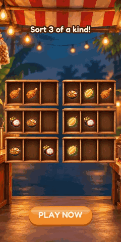
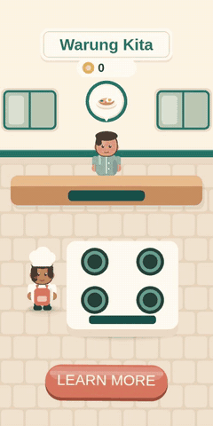
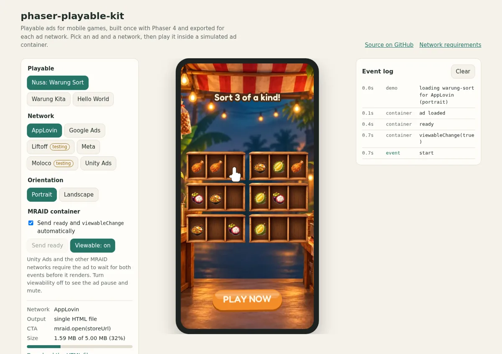

# phaser-playable-kit

[](https://github.com/AlvaroMillanEstevez/phaser-playable-kit/actions/workflows/ci.yml)
[](LICENSE)

An open source kit for building **playable ads** for mobile games with
[Phaser 4](https://phaser.io), [Vite](https://vite.dev) and TypeScript. It is for game
developers and studios that create playable ads: write the ad once, then get a
network-ready file for each ad network, checked against that network's rules.

**[Open the live demo](https://alvaromillanestevez.github.io/phaser-playable-kit/)**: play
the example ads in a phone frame, switch network and orientation, send simulated MRAID
events and watch every CTA call in a log.

> **Status: v0.1.0, a new project in active development.** The API may still change. The
> ads have been tested in desktop Chromium with a simulated ad container, **not yet on
> physical phones or in the networks' own preview tools**. See the [roadmap](ROADMAP.md).

| Nusa: Warung Sort                                      | Warung Kita                                        | Demo page                              |
| ------------------------------------------------------ | -------------------------------------------------- | -------------------------------------- |
|  |  |  |

## Why

Each ad network wants something slightly different. Some use MRAID and `mraid.open()`,
others want `ExitApi.exit()` or `FbPlayableAd.onCTAClick()`. Size limits run from 2 MB to
5 MB, and the rules about audio, visibility and first-tap redirects differ too. This kit
keeps those differences in one small adapter per network, so the game code stays the same.

## Principles

- **Offline by design.** All code and assets are inlined and the ad makes no requests at
  runtime. The only external URL in any build is Google's `exitapi.js`, which Google
  requires.
- **No personal data.** No user or device identifiers. The runtime only produces anonymous
  in-ad events (`start`, `interaction`, `end`, `cta`), which never leave the page.
- **No AI model APIs** in the kit or in the ads.
- **Network rules enforced in code.** Gameplay starts only when the container is ready and
  the ad is viewable. Audio stays muted until the first interaction and while the ad is
  hidden. The CTA is ignored until the player has interacted with the gameplay.

## Networks

| Network   | Status    | Output      | Limit  | CTA                         |
| --------- | --------- | ----------- | ------ | --------------------------- |
| AppLovin  | supported | single HTML | 5 MB   | `mraid.open()`              |
| Unity Ads | supported | single HTML | < 5 MB | `mraid.open()`              |
| Google    | supported | ZIP         | 5 MB   | `ExitApi.exit()`            |
| Meta      | supported | single HTML | 2 MB   | `FbPlayableAd.onCTAClick()` |
| Moloco    | testing   | single HTML | < 5 MB | `FbPlayableAd.onCTAClick()` |
| Liftoff   | testing   | single HTML | 5 MB   | `mraid.open()`              |
| Mintegral | planned   | ZIP         | 5 MB   | `window.install()`          |
| TikTok    | planned   | ZIP         | 3 MB   | `window.openAppStore()`     |

- **Supported:** adapter implemented and tested against a simulated container, following
  the network's published requirements.
- **Testing:** implemented, but some requirements could not be confirmed in an official
  source.
- **Planned:** not implemented yet.

Requirements, sources and the reasoning behind each limit are in
[docs/networks.md](docs/networks.md). When sources disagree, the kit applies the strictest
limit. Meta's official page could not be read automatically, so its figures come from
secondary sources.

Build sizes of the examples:

| Playable          | MRAID networks and Moloco | Meta (limit 2 MB) | Google ZIP |
| ----------------- | ------------------------- | ----------------- | ---------- |
| Nusa: Warung Sort | 1.59 MB                   | 1.59 MB           | 0.53 MB    |
| Warung Kita       | 1.40 MB                   | 1.40 MB           | 0.38 MB    |

## Quick start

Requires Node.js 22.18 or newer (the build scripts are TypeScript run directly by Node).

```bash
npm install
npm run dev                  # hello-world in the browser, no ad network
npm run check                # typecheck, lint, format check and unit tests
npm run build                # every playable for every network → dist/
npm run size                 # fail if any build is over its network's limit
npm run validate             # static checks on every build
npm run test:e2e             # play every build in headless Chromium
npm run build:demo           # demo site → dist/site
npm run preview:demo         # serve it at http://localhost:4174
```

`npm run test:e2e` needs Chromium: run
`npx playwright-core install chromium-headless-shell`, or set `CHROME` to an executable.

## Build for one network

```bash
node scripts/build.ts --playable warung-sort --network meta,unity
```

The output is in `dist/<playable>/<network>/`: an `index.html`, plus a ZIP for networks
that require one. Upload the ZIP when there is one, and the HTML otherwise. To run the dev
server with a network's adapter:

```bash
PLAYABLE=warung-sort NETWORK=meta npm run dev
```

## Create a new ad

Copy `playables/hello-world` to `playables/<your-ad>`. The build finds it automatically.

```
playables/hello-world/
├── index.html            # page shell, loads src/main.ts
├── playable.config.ts    # id, title, orientation, store URLs
├── smoke.ts              # tells the smoke test where the CTA is and how to play
└── src/
    ├── main.ts           # creates the runtime and starts Phaser when allowed
    └── HelloScene.ts     # the game
```

Set `id` to the folder name and fill in your store URLs. The runtime hides the network:

```ts
const runtime = createPlayable({ storeUrls: config.storeUrls });

runtime.start(() => {
  const game = new Phaser.Game({ /* ... */ scene: [new MyScene(runtime)] });
  bindPhaserGame(runtime, game); // audio and pause rules
});

// In the scene:
runtime.markInteraction(); // on gameplay input
runtime.cta(); // CTA button (ignored before the first interaction)
runtime.gameEnd(); // when the end card appears
```

Import images and fonts from your ad's folder and the build inlines them. Keep the top
corners and the bottom band free of interactive UI, and do not add a close button.
`src/kit/` has a tutorial hand and a button, and `src/core/synth.ts` plays sound effects
without audio files.

## Size budget and validator

`npm run size` measures the file you would upload (the HTML, or the ZIP and its file count)
and exits with an error if it is over the network's limit.

`npm run validate` analyses each build. It fails on external URLs, files that are not
inlined, a `mraid.js` tag, `fetch`, `WebSocket`, `sendBeacon`, iframes, cookies, tokens the
network forbids, and CTA code that does not match the network. Google builds also need
`exitapi.js`, the orientation tag and no self-closing tags. It warns about `XMLHttpRequest`
and storage references, which are unused code inside Phaser.

Moloco forbids `XMLHttpRequest` and Google forbids `localStorage`, so those builds rename
the identifiers. They only appear in Phaser code the ads do not run, and the smoke test
confirms the builds still play.

## Project structure

```
src/core/            runtime shared by every playable
  adapter.ts         NetworkAdapter interface
  runtime.ts         lifecycle, CTA guard, anonymous events
  audio.ts, synth.ts mute rules and synthesized sound effects
  phaser.ts          Phaser binding
  networks/          one adapter per network, plus build specs
src/kit/             reusable Phaser pieces (tutorial hand, button)
playables/           the ads: hello-world, warung-sort, warung-kita
scripts/             build, size budget, validator, demo site
tests/               Vitest unit tests and the Chromium smoke test
demo/                the demo page
tools/assets/        asset optimization
docs/networks.md     network requirements and sources
```

Phaser is 4.2.1, the same version as Nusa: Warung Sort. TypeScript is 6.0.3 because
typescript-eslint does not support the native TypeScript 7 compiler yet.

## Example games

The example ads are made from the author's own games:

- **Nusa: Warung Sort**, a sorting puzzle set in an Indonesian warung.
  [Play on itch.io](https://kokeskill.itch.io/nusa-warung-sort) ·
  [source](https://github.com/AlvaroMillanEstevez/nusa-sorting)
- **Warung Kita**, a warung management game, in development.
  [Source](https://github.com/AlvaroMillanEstevez/warung-game)

The origin and licence of every asset are in [ASSETS.md](ASSETS.md).

## How AI was used

This project was built with AI assistance, and this is what that means in practice.

**Decided by the author:** the idea and goals, the architecture and its constraints (no AI
APIs, no personal data, no runtime requests, own assets only), the starting table of network
requirements, the work plan, the mechanics of each ad, the font and the store URLs, and the
approval of every phase. The two games the ads come from are also the author's.

**Generated with AI tools:** Claude Code wrote the large majority of the kit's code, tests
and documentation under that direction, and looked up each network's sources. The art of
Nusa: Warung Sort was generated with ChatGPT from the author's prompts.

**How it was reviewed and validated:** 147 unit tests, the size budget, the static validator
and a smoke test that loads all 18 builds in headless Chromium, all run in CI. The two
example ads were also played from start to finish in the browser and reviewed through
screenshots. **They have not been tested on physical phones or in the networks' own
preview tools yet**; that is the first item of the roadmap.

## Working with the author

Alvaro Millan Estevez builds playable ads for studios and user acquisition agencies. Get in
touch through the [GitHub profile](https://github.com/AlvaroMillanEstevez).

## License

[MIT](LICENSE) © Alvaro Millan Estevez. Assets keep the licences listed in
[ASSETS.md](ASSETS.md).
